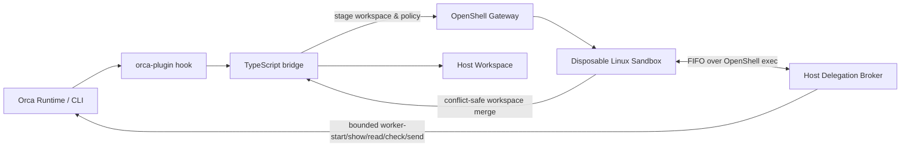
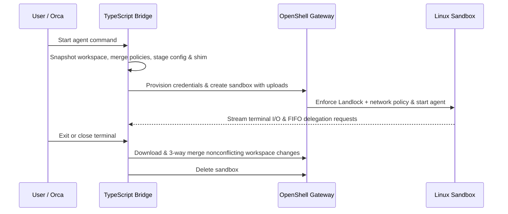

# ADE NVIDIA OpenShell Plugin (`ade-nvidia-openshell-plugin`)

Run **Claude Code**, **Google Antigravity**, and **OpenAI Codex** in disposable Linux sandboxes managed by **NVIDIA OpenShell**—both standalone and natively integrated with **Orca** (including Structured Chat Mode, Terminal Mode, L7 Egress Approval Popups, and in-sandbox worker orchestration).

For detailed Orca orchestration architecture and usage, see [`docs/ORCA_INTEGRATION.md`](docs/ORCA_INTEGRATION.md).

The repository includes:
- A trusted Orca launch hook & policy inspector plugin in [`orca-plugin/`](orca-plugin/) (`local.openshell-bridge`) that routes terminal launches of `claude`, `antigravity`/`agy`, and `codex` into isolated OpenShell sandboxes and adds an interactive **OpenShell Policies** sidebar panel coupling allowed policies to compatible CLI commands.
- A host-side FIFO delegation broker (`orca-delegation`) that allows a sandboxed coordinator agent to securely spawn and supervise worker agents in separate OpenShell sandboxes without exposing host sockets or Orca runtime tokens.
- Dedicated Orca Landlock & network policies in [`policies/`](policies/).



## Quick start

Requirements: Docker with a running daemon, the OpenShell CLI, Orca CLI (`1.4.248+`), Bash, Python 3, and Bun to bundle the TypeScript source. `yq` is optional for YAML policies.

From the repository root:

```sh
./install.sh
./scripts/install-orca-host.sh
orca plugin install "$(pwd)/orca-plugin" --json
export PATH="$HOME/.local/bin:$PATH"
```

1. `./install.sh` builds the three container images (`openshell-claude:latest`, `openshell-antigravity:latest`, `openshell-codex:latest`), imports OpenShell provider profiles, and installs standalone wrappers.
2. `./scripts/install-orca-host.sh` bundles and installs `agent-box` (`claude-box`, `agy-box`, `codex-box`), `orca-delegation`, `orca-delegation-shim.js`, the Orca policies under `~/.agents/orca-openshell-policies/`, and configures Orca's `agentCmdOverrides` so **both Chat Mode (`--surface chat`) and Terminal Mode (`--surface terminal`)** launch inside OpenShell sandboxes.
3. `orca plugin install` activates the `agent.launch.before` hook, the `OpenShell: Enforced` status bar indicator, and the **OpenShell Policies** inspector panel in Orca.

### Standalone usage

```sh
claude-box -p "Summarize the current changes"
agy-box --prompt "Explain Landlock briefly"
codex-box app-server
```

### Orca Chat Mode, Terminal Mode & Policy Inspector

See [`orca-plugin/README.md`](orca-plugin/README.md) for the complete plugin behavior reference and [`docs/ORCA_INTEGRATION.md`](docs/ORCA_INTEGRATION.md) for orchestration details:

- **1-Click Per-Worktree Sandbox Toggle (`On` ↔ `Off / Host Mode`)**: Click the **`OpenShell: Enforced (...)`** status bar item at the bottom of Orca (or the **Sandbox Mode** switch inside the **OpenShell Policies** panel) to toggle sandboxing for the active git worktree (`~/.agents/orca-openshell-policies/worktree-sandbox-mode.json`). Both Terminal Mode (`agent.launch.before`) and Chat Mode (`claude-box`, `codex-box`, `agent-box`) respect this per-worktree setting immediately.
- **Interactive "Test CLI Command" Evaluator & Live Runner**: Enter any command in the **OpenShell Policies** panel to evaluate it against `DENY > ASK > ALLOW` permission rules, Landlock write paths, and L7 egress rules **and execute it live** inside the active worktree's OpenShell sandbox (or on the host when `Sandbox Mode` is `Off`), displaying exit code, duration, `stdout`, `stderr`, and 1-click L7 rule buttons if an outbound request was blocked.
- **Three Compact Inspector Tabs with Opaque Hover Tooltips**:
  - **CLI Commands**: Foldable application cards (`git`, `docker`, `kubectl`, `orca`, etc.) with compact inner rule rows (`allow` / `ask` / `deny` dot, command pattern, policy group pill) and instant hover tooltips showing the rule rationale, source YAML file, and synced agent configs.
  - **Sandbox Egress**: Foldable HTTPS/L7 host cards with inner binary pills (`agy`, `claude`, `codex`, `curl`, `gh`) and HTTP `METHOD /path/**` sub-cards; hovering any inner pill or sub-card shows the container binary path, rationale, and source policy file. Includes `+ Add Egress Rule` for `Session`, `Project`, or `Global` scopes.
  - **Sandbox System**: Active sandbox lifecycle controls (`Pause`, `Resume`, `Stop & Delete` with automatic pre-delete workspace download/sync), `OpenShell Doctor` health diagnostics, native `.claude` / `.codex` / `.gemini` policy sync status, and Landlock filesystem mounts.
- **Zero Host Capabilities (`"capabilities": []`)**: `local.openshell-bridge` runs as a `trusted-worker` with zero requested Orca host capabilities (`pty`, `worktrees`, `agents`, `git`, `browser`, `storage`, `network`, and `shell` are all unrequested).
- **Chat Mode (`surface: "chat"`)**:
  - **Claude & Codex**: Runs `claude-box` / `codex-box` with `ORCA_STRUCTURED_SESSION=1` over full-duplex SSH streaming (`openshell sandbox ssh-config`), rewrites host/container paths in real time, and merges workspace changes and session transcripts back to the host at the end of every turn.
  - **Antigravity**: Routes `localharness_external` shell commands into a dedicated per-session OpenShell sandbox (`ag-safe-o-...`) via `agy-chat-sandbox.ts` with a persistent SSH `ControlMaster` channel and bidirectional delta sync.
- **Interactive L7 Egress Approval Popup (2-LLM-Turn Flow)**: When a sandboxed command hits an unapproved outbound host or HTTP method/path (`403 Forbidden` / `X-OpenShell-Policy`), `agent-box` intercepts the block on the host, displays an interactive popup modal (`Session only`, `Project`, `Global`, or `Keep Blocked`), hot-reloads the running sandbox policy via `openshell policy set`, and automatically retries the command inside the same tool call.
- **Terminal Mode (`surface: "terminal"`)**: Launching any supported agent in an Orca terminal (`orca agent launch --agent claude --surface terminal`) wraps the interactive TUI inside an OpenShell sandbox via the `local.openshell-bridge` launch hook.
- **Remote K3s / Multi-Gateway Support**: Because workspace staging (`openshell sandbox create --upload`), file sync (`openshell sandbox download`), command execution (`openshell sandbox ssh-config`), and L7 policy updates (`openshell policy set`) all run over the `openshell` gateway API and SSH tunnels rather than local Docker bind-mounts, pointing `openshell gateway select <k3s-gateway>` at a remote K3s cluster runs sandboxes remotely without code changes.

To allow a coordinator (in either Chat Mode or Terminal Mode) to spawn worker agents in their own isolated sandboxes:

1. **Automatic Grant (Recommended)**:
   Set `ORCA_AUTO_GRANT_DELEGATION=1` in your environment or add `<project>/.agents/delegation.json`:
   ```json
   {
     "autoGrant": true,
     "agents": ["claude", "antigravity", "codex"],
     "maxWorkers": 2,
     "maxDepth": 1
   }
   ```
2. **Manual Grant**:
   ```sh
   ~/.local/bin/orca-delegation grant \
     --terminal '<handle>' --workspace 'id:<workspace-id>' \
     --agents claude,antigravity,codex --max-workers 2 --max-depth 1
   ```

Inside the coordinator sandbox, standard Orca orchestration commands work transparently via the shim:
```sh
orca orchestration worker-start --spec "Run tests and report status" --agent claude --worktree current --json
orca orchestration worker-show --dispatch '<dispatch-id>' --json
orca orchestration worker-read --dispatch '<dispatch-id>' --json
orca orchestration check --peek --json
```

## How a session works



## Configuration

Policies are read from `~/.agents/policies/` (or `~/.agents/orca-openshell-policies/` for Orca launches) and merged with project-specific policies in `<project>/.agents/policies/`.

| Variable | Purpose |
| --- | --- |
| `ORCA_AUTO_GRANT_DELEGATION` | Set to `1` to automatically grant top-level Orca coordinator terminals permission to delegate workers (`depth: 0 -> 1`). |
| `ORCA_SANDBOX_WRITE_PATHS` | JSON array of existing relative file or directory paths allowed to be written, such as `'["src","README.md"]'`. Paths cannot include `.git`, escape the workspace, or traverse symlinks. |
| `ORCA_SANDBOX_EXTRA_PROVIDERS` | JSON array of additional OpenShell provider names, such as `'["github"]'`. |
| `ORCA_SANDBOX_CPU` | Optional CPU limit, for example `2` or `500m`. |
| `ORCA_SANDBOX_MEMORY` | Optional memory limit, for example `4Gi`. |
| `ORCA_SANDBOX_BOUNDARY_POLICY` | Master policy file checked by `openshell-prover` before sandbox creation; a missing tool or failed check stops the session. |

When `PASEO_AGENT_ID` is set, an omitted write-path list means no project paths are writable. The agent's private configuration area remains writable inside its sandbox. Scoped sessions sync back only the selected workspace paths.

Credentials are collected from supported host environment variables, macOS Keychain (`Claude Code-credentials-*`), and agent configuration files, then registered with OpenShell providers using profile-accepted keys. The bridge replaces known credential values in staged files with OpenShell placeholders and blocks uploads if it finds raw credentials in the workspace. See [`docs/SECURITY.md`](docs/SECURITY.md).

## Paseo

Set the provider command in Paseo's `~/.paseo/config.json` to the installed wrapper path, then reload Paseo:

```json
{
  "agents": {
    "providers": {
      "claude": { "command": ["/Users/you/.local/bin/claude-box"] },
      "codex": { "command": ["/Users/you/.local/bin/codex-box"] }
    }
  }
}
```

## Testing & Verification

```sh
# Typecheck and unit tests
node ts/node_modules/typescript/bin/tsc --noEmit -p ts/tsconfig.json
node ts/node_modules/typescript/bin/tsc --noEmit -p orca-plugin/tsconfig.json
(cd ts && bun test)
orca plugin test orca-plugin --json

# Live OpenShell smoke tests
./scripts/smoke-bridge.sh claude
./scripts/smoke-bridge.sh antigravity
./scripts/smoke-isolation.sh claude
./scripts/smoke-delegation-transport.sh claude
./scripts/smoke-orca-worker.sh '<coordinator-handle>' '<workspace-id>' '<coordinator-sandbox-name>' claude
```

## Repository map

- `ts/src/` — TypeScript bridge, agent adapters (`claude`, `antigravity`, `codex`), FIFO delegation broker, and conflict-safe workspace merger
- `orca-plugin/` — Orca `agent.launch.before` worker plugin (`local.openshell-bridge`)
- `scripts/` — Host installer and live smoke test suite
- `docker/` — Base and per-agent container Dockerfiles
- `profiles/` — OpenShell provider profiles (`claude-code`, `antigravity`, `codex`, `codex-orca`)
- `policies/` — Default and Orca-specific Landlock & network policies
- `docs/` — [`ORCA_INTEGRATION.md`](docs/ORCA_INTEGRATION.md), [`SECURITY.md`](docs/SECURITY.md), and [`OPENSHELL_CODEX_ORCA_INTEGRATION.md`](docs/OPENSHELL_CODEX_ORCA_INTEGRATION.md)
