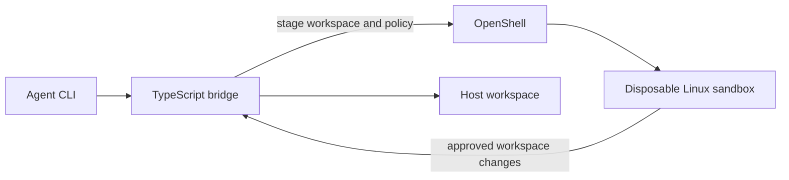
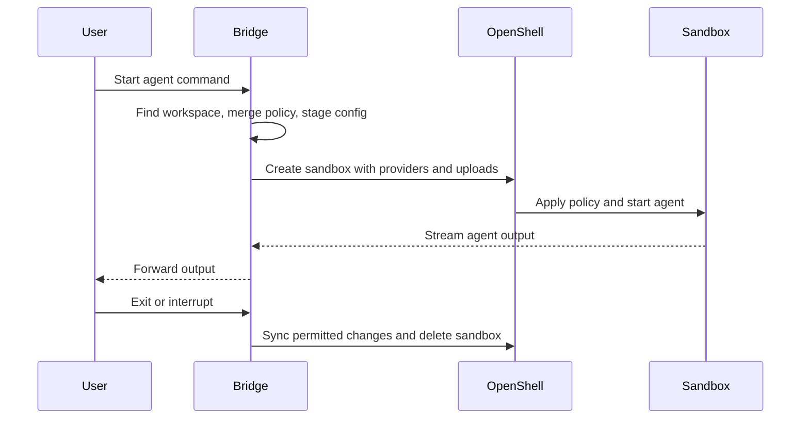

# OpenShell Agent Bridges

For Orca orchestration integration, see [the Orca integration status](docs/ORCA_INTEGRATION.md).
The repository includes a versioned Orca launch hook in [`orca-plugin/`](orca-plugin/)
and dedicated Orca policy files. Terminal Codex and Claude launches can be routed
through the existing bridge; the coordinator-to-Orca delegation path remains
unimplemented because the installed Orca CLI requires a full runtime token.

Run Codex, Claude Code, and Google Antigravity in disposable Linux sandboxes managed by NVIDIA OpenShell. The TypeScript bridge is the default installed implementation; the Python scripts in `bin/` are retained as reference bridges.



## Quick start

Requirements: Docker with a running daemon, the OpenShell CLI, Bash, Python 3, and Bun to bundle the TypeScript source. The installer has an npm/TypeScript fallback. `yq` is optional but recommended for YAML policies. The project has been exercised on macOS; other host setups depend on OpenShell and Docker compatibility.

From the repository root:

```sh
./install.sh
export PATH="$HOME/.local/bin:$PATH"
codex-box
```

The installer builds the three images, imports OpenShell profiles, installs policies under `~/.agents/policies/`, and installs `agy-box`, `codex-box`, and `claude-box` under `~/.local/bin/`. Use `./install.sh --rebuild` to rebuild images. `--help` and `--version` are passed through to a host agent when one is available.

```sh
agy-box --print "Explain Landlock briefly"
codex-box app-server   # Codex JSON-RPC app-server for IDE clients
claude-box -p "Summarize the current changes"
```

## How a session works



The workspace is discovered from the Git root, or the current directory if it is not in a Git repository. By default, standalone sessions can write throughout the workspace. Paseo delegated sessions are read-only unless `ORCA_SANDBOX_WRITE_PATHS` grants specific paths. Codex app-server mode uses newline-delimited JSON-RPC over stdio and rewrites workspace paths for the sandbox.

## Configuration

Policies are read from `~/.agents/policies/` and `<project>/.agents/policies/`. JSON and YAML files are merged; filesystem path rules are combined and deduplicated, while later processed scalar and same-name network settings replace earlier ones. Start with the examples in [`policies/`](policies/).

| Variable | Purpose |
| --- | --- |
| `ORCA_SANDBOX_WRITE_PATHS` | JSON array of existing relative file or directory paths allowed to be written, such as `'["src","README.md"]'`. Paths cannot include `.git`, escape the workspace, or traverse symlinks. |
| `ORCA_SANDBOX_EXTRA_PROVIDERS` | JSON array of additional OpenShell provider names, such as `'["github"]'`. |
| `ORCA_SANDBOX_CPU` | Optional CPU limit, for example `2` or `500m`. |
| `ORCA_SANDBOX_MEMORY` | Optional memory limit, for example `4Gi`. |
| `ORCA_SANDBOX_BOUNDARY_POLICY` | Master policy file checked by `openshell-prover` before sandbox creation; a missing tool or failed check stops the session. |

When `PASEO_AGENT_ID` is set, an omitted write-path list means no project paths are writable. The agent's private configuration area remains writable inside its sandbox. Scoped sessions sync back only the selected workspace paths.

Credentials are collected from supported host environment variables and agent configuration files, then registered with OpenShell providers. Codex reads `~/.codex/auth.json` and `OPENAI_API_KEY`; Claude reads `CLAUDE_CODE_OAUTH_TOKEN`, `ANTHROPIC_API_KEY`, or `CLAUDE_API_KEY` (also macOS Keychain); Antigravity reads Google token variables and `~/.gemini` auth files. The bridge replaces known credential values in staged files and blocks uploads if it finds those values in the workspace. This scan only knows credentials the bridge discovered; it is not a general secret scanner. See [the security notes](docs/SECURITY.md).

## Paseo

Set the provider command in Paseo's `~/.paseo/config.json` to the installed wrapper path, then reload Paseo:

```json
{
  "agents": {
    "providers": {
      "codex": { "command": ["/Users/you/.local/bin/codex-box"] }
    }
  }
}
```

Use the matching `claude-box` or `agy-box` command for other providers. Configure delegated scopes through an agent-specific launch environment; provider-level environment settings apply to every agent using that provider.

## Troubleshooting

- **`openshell` or Docker unavailable:** verify both commands are on `PATH` and the Docker daemon is running.
- **Provider authentication fails:** rerun the installer to import/update profiles, then confirm the agent is signed in on the host.
- **Sandbox creation or policy fails:** inspect `~/.orca/openshell-bridge.log`; if using `ORCA_SANDBOX_BOUNDARY_POLICY`, confirm `openshell-prover` is installed and the boundary file is readable.
- **A scoped path is rejected:** it must already exist, be relative to the project root, and contain no symlink traversal or `.git` metadata.

## Development

The TypeScript source is in `ts/src/`. With Bun installed, run `cd ts && bun run typecheck` to check types or `bun run bundle` to create the standalone executable. The installer includes an npm build fallback.

## Repository map

- `ts/src/` — default TypeScript bridge and agent adapters
- `bin/` — installed wrappers and Python reference bridges
- `docker/` — base and per-agent container images
- `profiles/` — OpenShell provider profiles
- `policies/` — default and agent network/filesystem policy examples
- `docs/` — security notes and historical integration report
