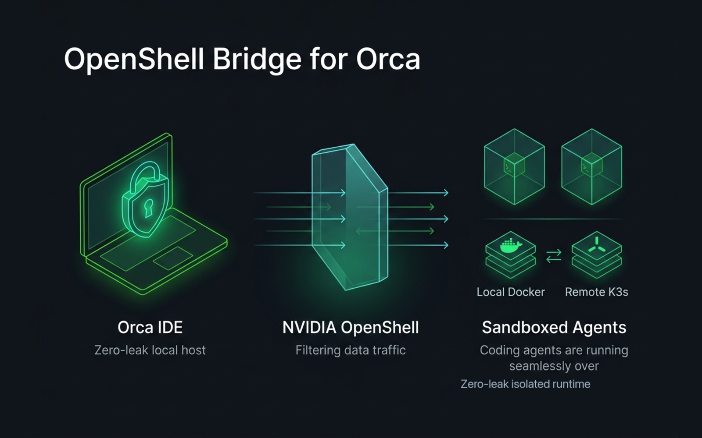
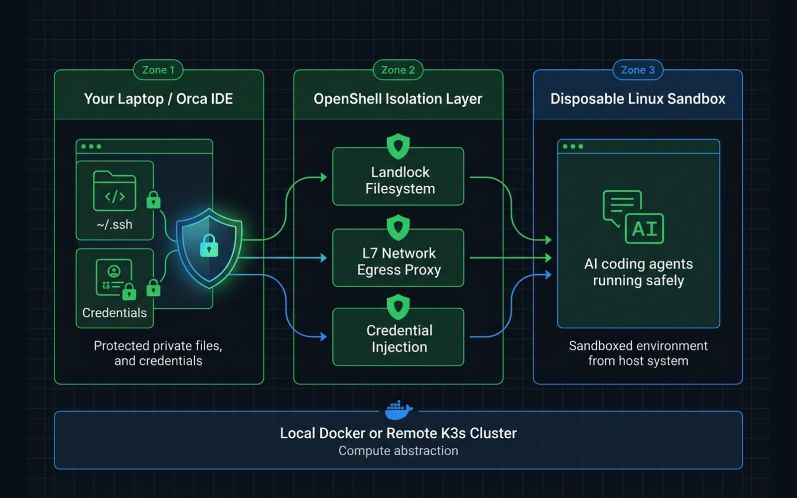
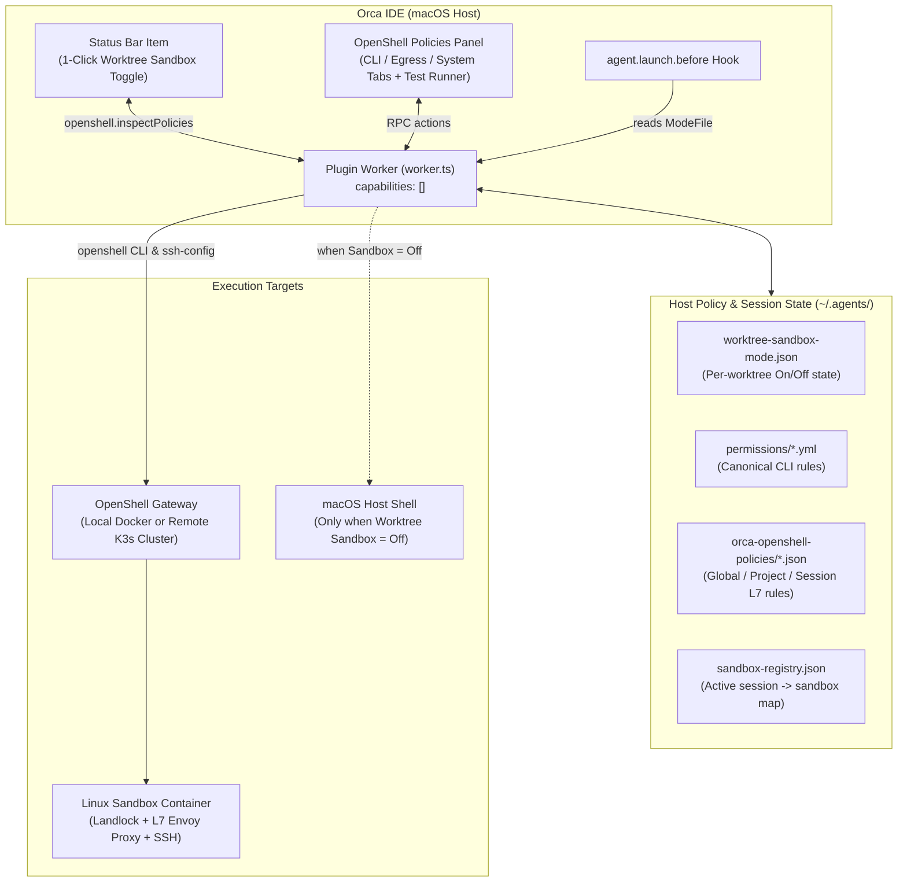
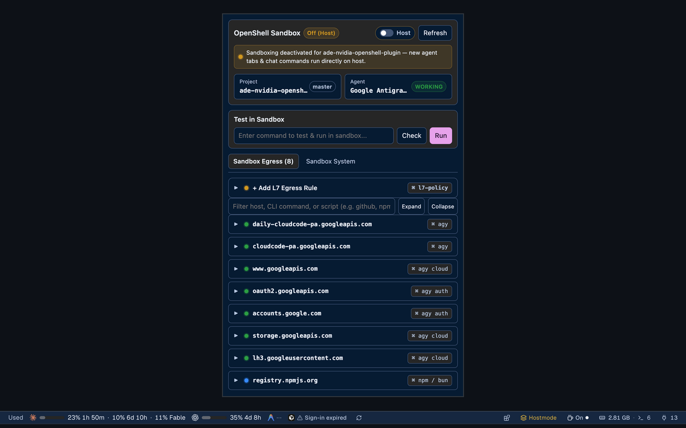

# ADE NVIDIA OpenShell Plugin — Orca Bridge & Policy Inspector (`local.openshell-bridge`)



> [!NOTE]
> **For Orca Catalog Maintainers & Security Reviewers**:
> Please refer to [`REVIEW_GUIDE.md`](REVIEW_GUIDE.md) for the 30-second audit summary, zero-network-call verification, subprocess boundary breakdown, and unit test reproduction instructions.

`local.openshell-bridge` (`v0.3.8`, part of `ade-nvidia-openshell-plugin`) is an Orca `1.4.248+` plugin that integrates **NVIDIA OpenShell** disposable Linux sandboxes with Orca **Terminal Mode**, **Structured Chat Mode**, **L7 Network Egress Popups**, and an interactive **OpenShell Policies** sidebar inspector.

---

## 0. Intent: Zero-Leak Agentic Coding on Your Own Machine

When you use an agentic IDE like **Orca** on your own laptop or workstation, autonomous coding agents (`Claude Code`, `OpenAI Codex`, `Google Antigravity`) are most useful when they can freely read code, run builds, install dependencies, and talk to approved APIs. At the same time, you want a strict guarantee that **nothing from your direct computer can leak**:

- Your personal files, unrelated repositories, browser cookies, `~/.ssh` keys, and local cloud credentials never enter the agent's execution environment.
- Outbound network requests cannot silently exfiltrate repository contents or secrets to unapproved hosts.
- **How sandboxes are provided shouldn't be your concern**: whether OpenShell spins up containers locally via **Docker / Podman / MicroVM** or provisions them on a remote **Kubernetes / K3s** cluster (`openshell gateway select`), OpenShell manages sandbox lifecycle, isolation, and teardown transparently behind the same contract.

### What NVIDIA OpenShell Does (and Typical Use Cases)

[NVIDIA OpenShell](https://docs.nvidia.com/openshell/latest/about/overview) (an open-source CNCF Sandbox project) is a safe, private runtime built specifically for autonomous AI agents. Rather than relying on prompt-level rules inside the agent, OpenShell enforces isolation **outside the agent process** across a three-component split (**Gateway** control plane, trusted **Supervisor**, and untrusted **Sandbox**):

| Threat / Need | How NVIDIA OpenShell Handles It |
| :--- | :--- |
| **Host file & secret leakage** | Kernel-level **Landlock** filesystem policies lock reads/writes strictly to the staged worktree and declared agent state paths. `~/.ssh`, cloud configs, and unrelated host folders are unreachable. |
| **Network data exfiltration** | **seccomp** interception plus a deny-by-default outer network fence force every TCP/DNS request through the trusted Supervisor's L7 proxy (`binary`, `host`, `port`, `HTTP method`, and `path`). |
| **API key exposure** | Real keys live outside the sandbox in **OpenShell Providers**. Agents only see opaque credential placeholders, and the Supervisor injects real credentials solely into requests bound for approved endpoints. |
| **Privilege escalation** | Sandboxes run as a non-root identity with zero Linux capabilities and seccomp syscall filtering (`sudo` and escalation paths are blocked). |
| **Auditable policy updates** | OpenShell's formal **policy prover** checks proposed rule changes before activation so risky new reach requires explicit human approval. |

In the broader OpenShell ecosystem, developers and teams typically use OpenShell for **secure coding agents** (`Claude Code`, `Codex`, `OpenCode`, `GitHub Copilot CLI`), **private enterprise development** (routing to self-hosted or approved inference endpoints without leaking sensitive context), **auditable version-controlled compliance policies**, and **reusable containerized environments** portable across laptops and Kubernetes clusters.



---

## 1. Architecture & Zero-Capability Security Model



### Why `trusted-worker` with `"capabilities": []`?
Orca plugins have two trust tiers:
- **Declarative (`ui-only`)**: Static themes/grammars with no code execution.
- **Worker (`trusted-worker`)**: Runs a Node.js worker (`src/worker.ts`) required to register `agent.launch.before` hooks, read local YAML/JSON policies, and invoke `openshell`.

Within `trusted-worker`, `local.openshell-bridge` declares **`"capabilities": []`** in [`orca-plugin.json`](orca-plugin.json) — requesting **zero** Orca host orchestration capabilities (`pty`, `worktrees`, `agents`, `git`, `browser`, `storage`, `network`, or `shell` are **not** requested). It uses only event hooks (`agent.launch.before`, `worktree.switched`, `agent.status`) and direct `execFile` calls to the `openshell` binary.

---

## 2. Per-Worktree Sandbox Toggle (`On` vs `Off / Host Mode`)

Every git worktree / workspace in Orca can independently run with OpenShell sandboxing **On (default)** or **Off (Host Mode)**.

### How to Toggle
1. **1-Click Status Bar Toggle**: Click the **`OpenShell: Enforced (...)`** or **`OpenShell: Off (Host Mode)`** item in Orca's bottom status bar (`openshell.inspectPolicies`).
   - Immediately flips sandboxing for the active worktree, displays a toast notification, updates the status bar badge, and live-refreshes the **OpenShell Policies** panel if open.
2. **Sidebar Panel Toggle**: Open the **OpenShell Policies** panel and click the toggle switch in the top **Sandbox Mode** card.

### What Happens in Each Mode
| Surface | Sandbox Mode `ON` (`Enforced`) | Sandbox Mode `OFF` (`Host Mode`) |
| --- | --- | --- |
| **Terminal Mode (`surface: "terminal"`)** | `agent.launch.before` rewrites `claude`, `codex`, and `antigravity` launches to `claude-box`, `codex-box`, and `agy-box` inside an OpenShell container. | `agent.launch.before` returns `{}` (no rewrite); the agent launches directly on the macOS host. |
| **Chat Mode (`surface: "chat"`)** | `claude-box`, `codex-box`, and `agent-box agy-chat-exec` stream tool calls into the worktree's OpenShell sandbox over SSH. | `agent-box` / wrappers detect the worktree entry in `~/.agents/orca-openshell-policies/worktree-sandbox-mode.json` and exec directly on the host. |
| **Test CLI Command (Panel)** | Evaluates policy AND runs the command inside the active worktree's OpenShell sandbox (`Sandbox: <name>` badge). | Evaluates policy AND runs the command in the worktree directory on your macOS host shell (`Host Mode` badge). |

> [!NOTE]
> Even when a worktree is in **Host Mode**, canonical `DENY` rules from `~/.agents/permissions/*.yml` (such as `security-baseline.yml`) remain synced to native host agent configs (`~/.claude/settings.json`, `~/.codex/rules/default.rules`, `~/.gemini/policies/managed-permissions.toml`).

---

## 3. Interactive "Test CLI Command" Evaluator & Live Runner

At the top of the **OpenShell Policies** panel, the **Test CLI Command** box both **evaluates** a command against all active policies and **executes** it in the active worktree:

1. **Static Policy Evaluation**:
   - Checks canonical CLI permission rules (`DENY > ASK > ALLOW`) from `~/.agents/permissions/*.yml`.
   - Checks `orca orchestration` delegation rules (`<project>/.agents/delegation.json`) and FIFO shim boundaries.
   - Infers target hosts/URLs (e.g. `curl https://api.github.com/...`, `gh pr list`, `npm install`) and checks whether the active L7 egress policy allows the `(binary, host, port, method, path)` tuple.
   - Checks Landlock filesystem write paths (`/sandbox/<worktree>`, `/tmp`, agent state dirs vs read-only `/usr`, `/etc`).
2. **Live Command Execution (`executeTestCliCommand`)**:
   - **Hard-Denied Commands**: Blocked before execution (`DENY` badge) so destructive commands cannot run.
   - **Sandbox Mode `ON`**: Executes inside the worktree's running OpenShell sandbox over `openshell sandbox ssh-config` (or provisions/reuses the worktree sandbox via `agent-box agy-chat-exec`).
   - **Sandbox Mode `OFF`**: Executes directly on the macOS host shell in the worktree directory.
   - **Output Card**: Displays the target badge (`Sandbox: <name>` or `Host Mode`), exit code (`exit 0` vs `exit <code>`), execution duration (`ms`), working directory, `stdout`, and `stderr`.
3. **Runtime L7 Block Detection**:
   - If the command's live output contains an OpenShell Envoy `403 Forbidden` / `X-OpenShell-Policy: denied` frame, the result card automatically extracts the blocked `(binary, host, port, method, path)` and renders 1-click **`+ Allow for Session`**, **`+ Allow for Project`**, and **`+ Allow Globally`** buttons.

---

### Live UI Overview



## 4. Inspector Tabs & Hover Tooltips

To keep the UI compact and scannable, rule rows avoid multi-line prose paragraphs and nested folds. Instead, hovering over any inner rule card or binary pill displays an **instant opaque floating tooltip (`#orcaTooltip`)** with the rule's rationale, binary path, and source policy file.

### Tab 1: `Sandbox Egress` (`egress-tab.ts`)
- **Manual L7 Rule Form (`+ Add Egress Rule`)**: Add an L7 HTTP rule (`host`, `port`, `method`, `path`, `binary`) to **Session** (hot-reloaded into the running sandbox via `openshell policy set`), **Project** (`<worktree>/.agents/policies/orca-project-egress.json`), or **Global** (`~/.agents/orca-openshell-policies/`).
- **Foldable Host Cards**: One card per allowed destination (`host:port`), showing:
  - Access mode dot (`read-write`, `read-only`, or `l7-rules`) and rule count.
  - **Inner Binary Pills (`.cli-chip`)**: Compact chips for each permitted binary (`agy`, `claude`, `codex`, `curl`, `gh`, `git`, `*`). **Hovering a binary pill** shows the binary's container path (e.g. `/usr/local/bin/agy`), why it needs that host, and which policy file defined it.
  - **Inner L7 Method/Path Cards (`.rule-row`)**: Compact rows for each allowed HTTP `METHOD /path/**` rule (`allow` badge + method/path + binary pill) with hover tooltips and a `Remove` button for custom session/project/global rules.

### Tab 2: `Sandbox System` (`system-tab.ts`)
- **Active Sandboxes**: Lists OpenShell sandboxes (`Running` / `Paused`) bound to the active Orca tab:
  - **`Pause` / `Resume`**: Runs `openshell sandbox stop <name>` / `openshell sandbox start <name>` while preserving container state and policies.
  - **`Delete`**: Runs [`syncSandboxWorkspaceBeforeDelete`](src/sandbox/sandbox-control.ts) (`openshell sandbox download` to rescue any uncommitted file edits back to the host worktree) before deleting the container (`openshell sandbox delete <name>`).
- **Sandbox Container Images & Missing Image Alarm**:
  - Inspects `openshell-base:latest`, `openshell-antigravity:latest`, `openshell-claude:latest`, and `openshell-codex:latest` with disk size, creation timestamp, role, and `READY` / `MISSING` badges.
  - If any image is missing or Docker is unavailable while Sandbox mode is enabled, triggers a top warning banner (with 1-click `Copy ./install.sh`), a tab alert badge (`!`), and a `Sandbox ⚠️` warning indicator in Orca's bottom status bar.
- **OpenShell Doctor (`Run Doctor`)**: Verifies:
  1. `openshell` CLI binary version & path.
  2. Active OpenShell Gateway reachability & running/paused sandbox counts.
  3. Host bridge wrappers (`agent-box`, `claude-box`, `codex-box`, `agy-box`) in `~/.local/bin`.
  4. Base L7 policy profiles (`claude.json`, `codex.json`, `antigravity.json`).
  5. Required Docker sandbox images (`openshell-base`, `openshell-codex`, `openshell-claude`, `openshell-antigravity`).
  6. Session registry health (automatically prunes stale sandbox entries).
- **Landlock Filesystem Mounts, Provider Credentials & Allowed Binaries**: Foldable cards with compact inner rows and hover tooltips for every read-only/read-write container path, proxy-injected credential placeholder, and executable path.

---

## 5. Using a Remote K3s OpenShell Gateway

Because `local.openshell-bridge` and `agent-box` interact with sandboxes exclusively through the `openshell` CLI (`sandbox create --upload`, `sandbox download`, `sandbox ssh-config`, `policy set`, `provider create/update`) rather than local Docker bind-mounts, **you can run your sandboxes on a remote K3s cluster**:

1. **Register and select your K3s gateway on your Mac**:
   ```sh
   openshell gateway add https://<your-k3s-gateway-endpoint> --name k3s
   openshell gateway login --gateway k3s   # if using OIDC / edge auth
   openshell gateway select k3s
   ```
   *(Or set `OPENSHELL_GATEWAY=k3s` / `OPENSHELL_GATEWAY_ENDPOINT=https://...` in the environment.)*
2. **Ensure sandbox images are available on K3s nodes**:
   Make sure `openshell-antigravity:latest`, `openshell-claude:latest`, and `openshell-codex:latest` are imported into K3s `containerd` (or pushed to a registry reachable by your K3s cluster).
3. **Verify in Orca**:
   Open **OpenShell Policies → Sandbox System** and click **`Run Doctor`**. The **OpenShell Gateway** check will verify connectivity to the active K3s gateway, and new worktree sandboxes, SSH sessions, file syncs, and L7 policy updates will execute against the K3s cluster.

---

## 6. Building & Extending Local Sandbox Dockerfiles

The four sandbox container images checked by **Sandbox Container Images** and **OpenShell Doctor** are built locally from [`../docker/`](../docker/):

1. [`Dockerfile.base`](../docker/Dockerfile.base) → **`openshell-base:latest`** (`node:20-bookworm`, build tools, Python 3, Go via `ARG GO_VERSION=1.26.2`, non-root `ubuntu` user, and `/home/ubuntu/.* -> /sandbox/.*` Landlock symlinks).
2. [`Dockerfile.claude`](../docker/Dockerfile.claude) → **`openshell-claude:latest`** (`FROM openshell-base:latest` + `@anthropic-ai/claude-code` + `combine-skills`).
3. [`Dockerfile.codex`](../docker/Dockerfile.codex) → **`openshell-codex:latest`** (`FROM openshell-base:latest` + `@openai/codex`).
4. [`Dockerfile.antigravity`](../docker/Dockerfile.antigravity) → **`openshell-antigravity:latest`** (`FROM openshell-base:latest` + `agy` / `antigravity` Linux CLI).

### Rebuild locally

```sh
# Rebuild all 4 images from the repository root
./install.sh --rebuild

# Or build individual layers manually (openshell-base:latest first)
docker build -t openshell-base:latest -f docker/Dockerfile.base docker
docker build -t openshell-claude:latest -f docker/Dockerfile.claude docker
docker build -t openshell-codex:latest -f docker/Dockerfile.codex docker
docker build -t openshell-antigravity:latest -f docker/Dockerfile.antigravity docker
```

### Extend with custom tools

- **All agents**: Edit [`docker/Dockerfile.base`](../docker/Dockerfile.base) before `USER ubuntu` and run `./install.sh --rebuild`.
- **Per-agent overlay** (without editing tracked files):
  ```dockerfile
  FROM openshell-claude:latest
  USER root
  RUN apt-get update && apt-get install -y --no-install-recommends gh && rm -rf /var/lib/apt/lists/*
  USER ubuntu
  WORKDIR /sandbox
  CMD ["bash"]
  ```
  Build and re-tag with the expected name (`docker build -t openshell-claude:latest -f Dockerfile.local .`). Keep `USER ubuntu`, `WORKDIR /sandbox`, runtime writes inside `/sandbox` or `/tmp` (Landlock locks `/usr` read-only), and the standard `openshell-*:latest` tag names so `OpenShell Doctor` and `agent-box` recognize your customized image automatically.

---

## 7. Build, Test & Install Commands

```sh
# Rebuild the bundled panel HTML (orca-plugin/panel/index.html)
bun ./scripts/build-orca-panel.ts

# Validate manifest and run the 11 unit/integration tests
orca plugin validate orca-plugin --json
orca plugin test orca-plugin --json

# Install / hot-reload into Orca
orca plugin install "$(pwd)/orca-plugin" --json
orca plugin open local.openshell-bridge --panel policies --json
```
