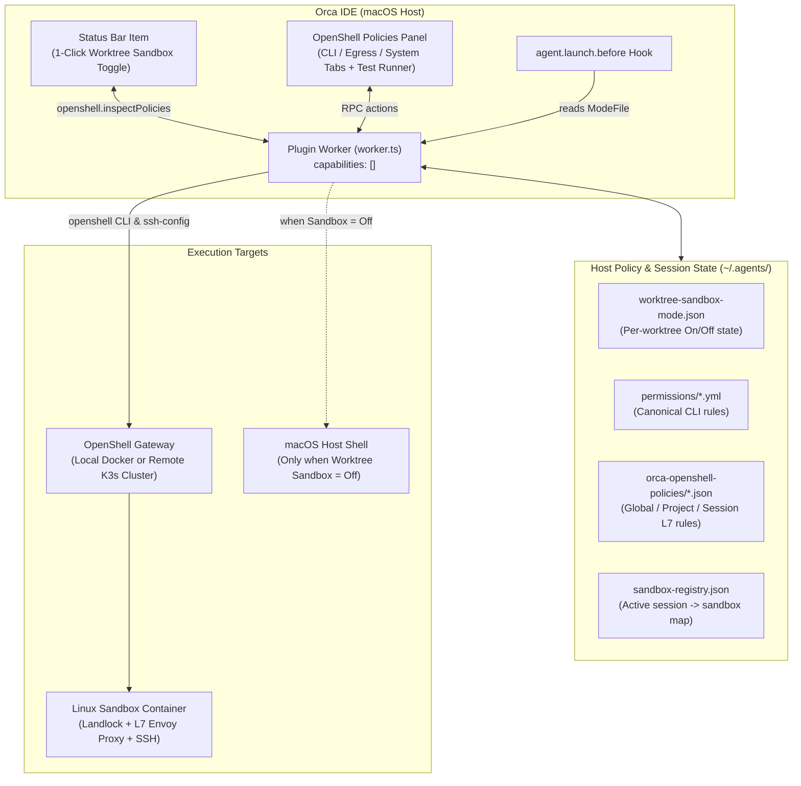

# ADE NVIDIA OpenShell Plugin — Orca Bridge & Policy Inspector (`local.openshell-bridge`)

> [!NOTE]
> **For Orca Catalog Maintainers & Security Reviewers**:
> Please refer to [`REVIEW_GUIDE.md`](REVIEW_GUIDE.md) for the 30-second audit summary, zero-network-call verification, subprocess boundary breakdown, and unit test reproduction instructions.

`local.openshell-bridge` (`v0.3.2`, part of `ade-nvidia-openshell-plugin`) is an Orca `1.4.248+` plugin that integrates **NVIDIA OpenShell** disposable Linux sandboxes with Orca **Terminal Mode**, **Structured Chat Mode**, **L7 Network Egress Popups**, and an interactive **OpenShell Policies** sidebar inspector.

---

## 1. Architecture & Zero-Capability Security Model



### Why `trusted-worker` with `"capabilities": []`?
Orca plugins have two trust tiers:
- **Declarative (`ui-only`)**: Static themes/grammars with no code execution.
- **Worker (`trusted-worker`)**: Runs a Node.js worker (`src/worker.ts`) required to register `agent.launch.before` hooks, read local YAML/JSON policies, and invoke `openshell`.

Within `trusted-worker`, `local.openshell-bridge` declares **`"capabilities": []`** in [`orca-plugin.json`](orca-plugin.json) — requesting **zero** Orca host orchestration capabilities (`pty`, `worktrees`, `agents`, `git`, `browser`, `storage`, `network`, or `shell` are **not** requested). It uses only event hooks (`agent.launch.before`, `worktree.switched`, `agent.status`) and direct `execFile` calls to the `openshell` binary.

---

## 2. Per-Worktree Sandbox Toggle (`On` vs `Off / Host Mode`)

Every git worktree / workspace in Orca can independently run with OpenShell sandboxing **On (default)** or **Off (Host Mode)**.

### How to Toggle
1. **1-Click Status Bar Toggle**: Click the **`OpenShell: Enforced (...)`** or **`OpenShell: Off (Host Mode)`** item in Orca's bottom status bar (`openshell.inspectPolicies`).
   - Immediately flips sandboxing for the active worktree, displays a toast notification, updates the status bar badge, and live-refreshes the **OpenShell Policies** panel if open.
2. **Sidebar Panel Toggle**: Open the **OpenShell Policies** panel and click the toggle switch in the top **Sandbox Mode** card.

### What Happens in Each Mode
| Surface | Sandbox Mode `ON` (`Enforced`) | Sandbox Mode `OFF` (`Host Mode`) |
| --- | --- | --- |
| **Terminal Mode (`surface: "terminal"`)** | `agent.launch.before` rewrites `claude`, `codex`, and `antigravity` launches to `claude-box`, `codex-box`, and `agy-box` inside an OpenShell container. | `agent.launch.before` returns `{}` (no rewrite); the agent launches directly on the macOS host. |
| **Chat Mode (`surface: "chat"`)** | `claude-box`, `codex-box`, and `agent-box agy-chat-exec` stream tool calls into the worktree's OpenShell sandbox over SSH. | `agent-box` / wrappers detect the worktree entry in `~/.agents/orca-openshell-policies/worktree-sandbox-mode.json` and exec directly on the host. |
| **Test CLI Command (Panel)** | Evaluates policy AND runs the command inside the active worktree's OpenShell sandbox (`Sandbox: <name>` badge). | Evaluates policy AND runs the command in the worktree directory on your macOS host shell (`Host Mode` badge). |

> [!NOTE]
> Even when a worktree is in **Host Mode**, canonical `DENY` rules from `~/.agents/permissions/*.yml` (such as `security-baseline.yml`) remain synced to native host agent configs (`~/.claude/settings.json`, `~/.codex/rules/default.rules`, `~/.gemini/policies/managed-permissions.toml`).

---

## 3. Interactive "Test CLI Command" Evaluator & Live Runner

At the top of the **OpenShell Policies** panel, the **Test CLI Command** box both **evaluates** a command against all active policies and **executes** it in the active worktree:

1. **Static Policy Evaluation**:
   - Checks canonical CLI permission rules (`DENY > ASK > ALLOW`) from `~/.agents/permissions/*.yml`.
   - Checks `orca orchestration` delegation rules (`<project>/.agents/delegation.json`) and FIFO shim boundaries.
   - Infers target hosts/URLs (e.g. `curl https://api.github.com/...`, `gh pr list`, `npm install`) and checks whether the active L7 egress policy allows the `(binary, host, port, method, path)` tuple.
   - Checks Landlock filesystem write paths (`/sandbox/<worktree>`, `/tmp`, agent state dirs vs read-only `/usr`, `/etc`).
2. **Live Command Execution (`executeTestCliCommand`)**:
   - **Hard-Denied Commands**: Blocked before execution (`DENY` badge) so destructive commands cannot run.
   - **Sandbox Mode `ON`**: Executes inside the worktree's running OpenShell sandbox over `openshell sandbox ssh-config` (or provisions/reuses the worktree sandbox via `agent-box agy-chat-exec`).
   - **Sandbox Mode `OFF`**: Executes directly on the macOS host shell in the worktree directory.
   - **Output Card**: Displays the target badge (`Sandbox: <name>` or `Host Mode`), exit code (`exit 0` vs `exit <code>`), execution duration (`ms`), working directory, `stdout`, and `stderr`.
3. **Runtime L7 Block Detection**:
   - If the command's live output contains an OpenShell Envoy `403 Forbidden` / `X-OpenShell-Policy: denied` frame, the result card automatically extracts the blocked `(binary, host, port, method, path)` and renders 1-click **`+ Allow for Session`**, **`+ Allow for Project`**, and **`+ Allow Globally`** buttons.

---

## 4. Three Inspector Tabs & Hover Tooltips

To keep the UI compact and scannable, rule rows avoid multi-line prose paragraphs and nested folds. Instead, hovering over any inner rule card or binary pill displays an **instant opaque floating tooltip (`#orcaTooltip`)** with the rule's rationale, binary path, and source policy file.

### Tab 1: `CLI Commands` (`cli-tab.ts`)
- Groups all rules from `~/.agents/permissions/*.yml` and `.agents/delegation.json` into foldable application cards (`git`, `docker`, `kubectl`, `orca`, `rm`, `chmod`, etc.).
- Summary header shows total rules and `allow` / `ask` / `deny` counts.
- Expanding an application card lists compact inner `.rule-row` items:
  - **Left**: Color-coded decision dot (`allow` green, `ask` amber, `deny` red) + CLI command pattern.
  - **Right**: Policy group pill (`⌘ <group>`).
  - **Hover Tooltip**: Shows the human-readable policy explanation, source YAML path, raw rule token, and synced agent config files.

### Tab 2: `Sandbox Egress` (`egress-tab.ts`)
- **Manual L7 Rule Form (`+ Add Egress Rule`)**: Add an L7 HTTP rule (`host`, `port`, `method`, `path`, `binary`) to **Session** (hot-reloaded into the running sandbox via `openshell policy set`), **Project** (`<worktree>/.agents/policies/orca-project-egress.json`), or **Global** (`~/.agents/orca-openshell-policies/`).
- **Foldable Host Cards**: One card per allowed destination (`host:port`), showing:
  - Access mode dot (`read-write`, `read-only`, or `l7-rules`) and rule count.
  - **Inner Binary Pills (`.cli-chip`)**: Compact chips for each permitted binary (`agy`, `claude`, `codex`, `curl`, `gh`, `git`, `*`). **Hovering a binary pill** shows the binary's container path (e.g. `/usr/local/bin/agy`), why it needs that host, and which policy file defined it.
  - **Inner L7 Method/Path Cards (`.rule-row`)**: Compact rows for each allowed HTTP `METHOD /path/**` rule (`allow` badge + method/path + binary pill) with hover tooltips and a `Remove` button for custom session/project/global rules.

### Tab 3: `Sandbox System` (`system-tab.ts`)
- **Active Sandboxes**: Lists all OpenShell sandboxes (`Running` / `Paused`), tagged with `current tab` when bound to the active Orca worktree:
  - **`Pause` / `Resume`**: Runs `openshell sandbox stop <name>` / `openshell sandbox start <name>` while preserving container state and policies.
  - **`Stop & Delete`**: Runs [`syncSandboxWorkspaceBeforeDelete`](src/sandbox/sandbox-control.ts) (`openshell sandbox download` to rescue any uncommitted file edits back to the host worktree) before deleting the container (`openshell sandbox delete <name>`).
- **OpenShell Doctor (`Run Doctor`)**: Verifies:
  1. `openshell` CLI binary version & path.
  2. Active OpenShell Gateway reachability & running/paused sandbox counts.
  3. Host bridge wrappers (`agent-box`, `claude-box`, `codex-box`, `agy-box`) in `~/.local/bin`.
  4. Base L7 policy profiles (`claude.json`, `codex.json`, `antigravity.json`).
  5. Session registry health (automatically prunes stale sandbox entries).
- **Policy Sync Status**: Shows whether `~/.agents/permissions/*.yml` is in sync with Claude, Codex, and Antigravity native settings, with a 1-click **`Sync Policy Files`** button.
- **Landlock Filesystem Mounts & Runtime Launch Details**: Foldable cards with compact inner rows and hover tooltips for every read-only and read-write container path.

---

## 5. Using a Remote K3s OpenShell Gateway

Because `local.openshell-bridge` and `agent-box` interact with sandboxes exclusively through the `openshell` CLI (`sandbox create --upload`, `sandbox download`, `sandbox ssh-config`, `policy set`, `provider create/update`) rather than local Docker bind-mounts, **you can run your sandboxes on a remote K3s cluster**:

1. **Register and select your K3s gateway on your Mac**:
   ```sh
   openshell gateway add https://<your-k3s-gateway-endpoint> --name k3s
   openshell gateway login --gateway k3s   # if using OIDC / edge auth
   openshell gateway select k3s
   ```
   *(Or set `OPENSHELL_GATEWAY=k3s` / `OPENSHELL_GATEWAY_ENDPOINT=https://...` in the environment.)*
2. **Ensure sandbox images are available on K3s nodes**:
   Make sure `openshell-antigravity:latest`, `openshell-claude:latest`, and `openshell-codex:latest` are imported into K3s `containerd` (or pushed to a registry reachable by your K3s cluster).
3. **Verify in Orca**:
   Open **OpenShell Policies → Sandbox System** and click **`Run Doctor`**. The **OpenShell Gateway** check will verify connectivity to the active K3s gateway, and new worktree sandboxes, SSH sessions, file syncs, and L7 policy updates will execute against the K3s cluster.

---

## 6. Build, Test & Install Commands

```sh
# Rebuild the bundled panel HTML (orca-plugin/panel/index.html)
node --experimental-strip-types scripts/build-orca-panel.ts

# Validate manifest and run the 9 unit/integration tests
orca plugin check orca-plugin --json
orca plugin test orca-plugin --json

# Install / hot-reload into Orca
orca plugin install "$(pwd)/orca-plugin" --json
orca plugin open local.openshell-bridge --panel policies --json
```
